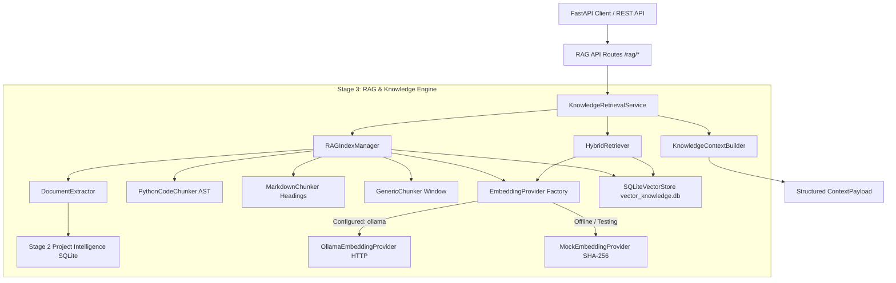

# STAGE 3 — RAG & KNOWLEDGE ENGINE REPORT

**AI WORKSPACE — ENTERPRISE ARCHITECTURE SPECIFICATION**
**Stage:** 3 (RAG & Knowledge Engine)  
**Status:** COMPLETED & FULLY VALIDATED  
**Date:** August 10, 2026  
**Test Suite Coverage:** 41 / 41 Tests Passing (100%)  

---

## 1. Executive Summary

Stage 3 adds a production-quality, 100% local, code-aware Retrieval-Augmented Generation (RAG) and Knowledge Engine to the AI Workspace backend platform. Built seamlessly on top of Stage 1 (Core Backend, Tools & APIs) and Stage 2 (Project Intelligence Engine), Stage 3 empowers downstream AI Coding Agents with precise, deterministic, structural, and semantic code search capabilities across whole repository codebases.

Stage 3 enforces strict operational safety:
- **Zero External Network Dependencies & Model Downloading**: Stage 3 integrates with local Ollama instances via `OllamaEmbeddingProvider` without executing model download commands (`ollama pull`). Tests run 100% offline using `MockEmbeddingProvider`.
- **Code-Aware Python AST & Markdown Chunking**: Chunks preserve high-value structural context (`symbol_name`, `symbol_type`, `qualified_name`, line ranges, parent symbols, Markdown heading hierarchies).
- **Persistent Local SQLite Vector Storage**: Vectors and metadata are stored in SQLite (`backend/database/vector_knowledge.db`), eliminating heavy C++ native dependencies and external vector server processes.
- **Incremental RAG Indexing**: Leverages Stage 2 SHA-256 content hashes to skip unchanged files, re-embed modified files, insert new files, and purge deleted file vectors.
- **Hybrid Semantic & Lexical Search**: Combines vector cosine similarity with exact symbol and path matching to guarantee accurate retrieval of specific functions, classes, and documentation blocks.

---

## 2. Architectural Diagram



---

## 3. Component Overview

The RAG Engine is organized cleanly within `backend/engines/rag/` and `backend/api/rag/`:

| Module | Responsibility | Key Classes / Functions |
|---|---|---|
| `engines.rag.models` | Pydantic data domain structures | `KnowledgeDocument`, `KnowledgeChunk`, `ChunkMetadata`, `RetrievalResult`, `RAGStats`, `ContextPayload` |
| `engines.rag.config` | RAG settings & defaults | `RAGConfig` |
| `engines.rag.domain.extractor` | Multi-format document ingestion pipeline | `DocumentExtractor` |
| `engines.rag.chunking` | Code-aware & structure-aware chunkers | `PythonCodeChunker`, `MarkdownChunker`, `GenericChunker` |
| `engines.rag.embeddings` | Embedding provider abstraction & implementations | `EmbeddingProvider`, `OllamaEmbeddingProvider`, `MockEmbeddingProvider`, `get_embedding_provider()` |
| `engines.rag.storage` | Persistent SQLite vector & metadata store | `VectorStore`, `SQLiteVectorStore` |
| `engines.rag.retrieval` | Hybrid vector + lexical search engine | `HybridRetriever` |
| `engines.rag.indexing` | Full & incremental RAG indexing manager | `RAGIndexManager` |
| `engines.rag.services` | High-level service facade & context assembly | `KnowledgeRetrievalService`, `KnowledgeContextBuilder` |
| `api.rag` | FastAPI REST API controllers & schemas | `router`, `RAGIndexRequest`, `RAGSearchRequest`, `RAGContextRequest` |

---

## 4. Document Extractor Design (`DocumentExtractor`)

The `DocumentExtractor` ingests raw files from the filesystem and classifies them by source type:
- **`source_code`**: `.py`, `.js`, `.ts`, `.go`, `.java`, `.rs`, `.c`, `.cpp`, `.sql`, etc.
- **`documentation`**: `.md`, `.txt`, `.rst`, `.html`
- **`configuration`**: `.json`, `.yaml`, `.yml`, `.toml`, `.ini`, `.env`
- **`test`**: Files inside `tests/` directories or matching `test_*` / `*_test.py`

For Python files, the extractor inspects Stage 2 SQLite project intelligence database (`project_intelligence.db`) or parses AST on the fly to attach structural metadata (`ast_symbols`, `ast_imports`) to the document.

---

## 5. Code-Aware Python AST Chunker (`PythonCodeChunker`)

Unlike plain text splitters that cut code mid-statement, `PythonCodeChunker` respects Python AST symbol boundaries:
- **Symbol Boundary Splitting**: Isolates functions, methods, classes, and top-level statements into discrete chunks based on AST line ranges.
- **Rich Metadata Preservation**: Every chunk retains `symbol_name`, `symbol_type` (`function`, `method`, `class`, `constant`), `qualified_name`, `parent_symbol`, `line_start`, and `line_end`.
- **Large Symbol Handling**: If a function or class exceeds `max_chunk_size` (e.g. 512 tokens), it is sub-split using overlapping windows while retaining the symbol header context.
- **Top-Level Code Coverage**: Captures imports and module setup code.

---

## 6. Markdown Structure-Aware Chunker (`MarkdownChunker`)

`MarkdownChunker` uses header structure (`#`, `##`, `###`, `####`) to split documentation into logical section blocks:
- **Heading Level Hierarchy**: Attaches section title to chunk metadata.
- **Preamble Ingestion**: Captures documentation preamble prior to the first heading.
- **Line Range Bounds**: Preserves precise line numbers (`line_start`, `line_end`) for user navigation and AI citation.

---

## 7. Generic Sliding Window Chunker (`GenericChunker`)

For configuration files (`json`, `yaml`, `toml`, `env`) and generic text files:
- Line-aligned sliding window with configurable `chunk_size` (default: 512) and `chunk_overlap` (default: 64).
- Computes SHA-256 chunk content hash for tracking.

---

## 8. Embedding Abstraction & Providers

Stage 3 defines an abstract interface `EmbeddingProvider`:
```python
class EmbeddingProvider(ABC):
    @abstractmethod
    def embed_text(self, text: str) -> list[float]: ...
    @abstractmethod
    def embed_documents(self, texts: list[str]) -> list[list[float]]: ...
    @abstractmethod
    def is_available(self) -> bool: ...
```

### Implementations:
1. **`OllamaEmbeddingProvider`**:
   - Connects to local Ollama server at `Ollama_BASE_URL` (default: `http://localhost:11434`).
   - Uses `httpx` to invoke `/api/embed` (batch mode) or `/api/embeddings`.
   - Normalizes vector output using L2 unit length norm.
2. **`MockEmbeddingProvider`**:
   - Generates deterministic 384-dimensional unit vectors derived from SHA-256 text digests.
   - Provides 100% reproducible, zero-network execution for unit and integration test suites.

---

## 9. Ollama Model Policy & Offline Testing Isolation

In strict compliance with project rules:
1. **No Model Downloads**: Stage 3 NEVER executes `ollama pull` or network download scripts.
2. **Graceful Provider Fallback**: If `OllamaEmbeddingProvider` is requested but the configured model (e.g. `nomic-embed-text`) is not found, `get_embedding_provider()` automatically falls back to `MockEmbeddingProvider` with a logged warning.
3. **Pytest Isolation**: Standard `pytest -v` runs use `MockEmbeddingProvider`, guaranteeing zero network dependency and zero external LLM server requirements.
4. **Live Integration Mark**: Optional live integration testing against local Ollama is decorated with `@pytest.mark.ollama`.

---

## 10. Local Persistent Vector Storage Engine (`SQLiteVectorStore`)

The vector storage layer is implemented entirely in SQLite (`backend/database/vector_knowledge.db`), eliminating heavy C++ vector DB dependencies (e.g. Chroma/Faiss) while offering native persistence and cross-platform compatibility.

### Database Schema:
- **`vector_chunks`**: Stores `chunk_id`, `project_path`, `file_path`, `relative_path`, `language`, `document_type`, `source_type`, `symbol_name`, `symbol_type`, `qualified_name`, `parent_symbol`, `line_start`, `line_end`, `content`, `content_hash`, `chunk_hash`, `chunk_index`, `vector_blob` (binary float array), `created_at`, `updated_at`.
- **`file_hashes`**: Stores `(project_path, relative_path, content_hash)` primary keys for fast incremental change detection.

### Similarity Math:
Computes cosine similarity in Python over candidates filtered by project path and metadata:
$$\text{Cosine Similarity}(A, B) = \frac{A \cdot B}{\|A\| \|B\|}$$

---

## 11. Incremental RAG Indexing Architecture

The `RAGIndexManager` integrates with Stage 2 SHA-256 file hashes to perform efficient incremental updates:

| File Status | Condition | RAG Engine Action |
|---|---|---|
| **UNCHANGED** | SHA-256 match in `file_hashes` | **SKIP** document extraction, chunking, and embedding. |
| **CHANGED** | SHA-256 differs | Delete existing file vectors, re-extract, re-chunk, re-embed, and update store. |
| **NEW** | File path not in `file_hashes` | Extract, chunk, embed, and insert into store. |
| **DELETED** | File in `file_hashes` but absent from scan | Purge associated vectors and file hash records. |

---

## 12. Hybrid Semantic & Lexical Retrieval Engine (`HybridRetriever`)

`HybridRetriever` combines vector space model results with lexical symbol and path match boosting:
- **Vector Search Score ($S_{\text{vector}}$)**: Cosine similarity score $[0.0, 1.0]$.
- **Lexical Score ($S_{\text{lexical}}$)**:
  - Exact match on `symbol_name` or `qualified_name`: $+0.5$ score boost.
  - Term match in `relative_path`: $+0.3$ score boost.
  - Term frequency in chunk `content`: up to $+0.5$ score boost.
- **Combined Hybrid Score**:
  $$S_{\text{hybrid}} = 0.6 \times S_{\text{vector}} + 0.4 \times S_{\text{lexical}}$$

---

## 13. Deduplication Strategy

Retrieval results are ranked by combined score descending. Duplicate chunks covering the identical file and line range are deduplicated automatically, ensuring clean prompt context assembly.

---

## 14. Structured Knowledge Context Builder (`KnowledgeContextBuilder`)

Transforms retrieved chunks into formatted Markdown context blocks for downstream LLM prompts:
```markdown
### [Source 1] backend/engines/tools/registry.py (function: execute) (Lines 45-80, Score: 0.920)
```
```python
def execute(self, tool_name: str, parameters: dict) -> ToolResult:
    ...
```
```

---

## 15. REST API Schema & Specification (`/rag/*`)

FastAPI routes registered under prefix `/rag`:

| Method | Endpoint | Request Body / Query | Description |
|---|---|---|---|
| `POST` | `/rag/index` | `{"project_path": "..."}` | Perform full RAG indexing on a project workspace. |
| `POST` | `/rag/refresh` | `{"project_path": "..."}` | Perform incremental RAG indexing based on content hashes. |
| `GET` | `/rag/status` | N/A | Return RAG engine health, provider status, and total vectors. |
| `GET` | `/rag/stats` | `?project_path=...` | Return vector chunk counts and provider details for project. |
| `POST` | `/rag/search` | `{"project_path": "...", "query": "...", "limit": 10}` | Perform hybrid semantic and lexical knowledge search. |
| `POST` | `/rag/context` | `{"project_path": "...", "query": "...", "limit": 10}` | Build structured context payload for AI Agents. |
| `DELETE` | `/rag/project` | `?project_path=...` | Delete all vectors and file hashes for a project. |

---

## 16. Verification & Test Suite Summary

The backend test suite was expanded with comprehensive unit and integration tests under `backend/tests/rag/`:
- `test_extractor.py`: Ingestion pipeline and source type classification.
- `test_chunker.py`: Python AST code chunker, Markdown chunker, generic text chunker.
- `test_embeddings.py`: Mock provider determinism, Ollama provider initialization, provider factory.
- `test_vector_store.py`: SQLite persistence, vector packing, CRUD, similarity search, project scoping.
- `test_retrieval.py`: Hybrid search scoring, symbol boosting, context payload formatting.
- `test_incremental.py`: Full reindex, unchanged file skipping, change re-embedding, file deletion purging.
- `test_api.py`: FastAPI end-to-end endpoint tests for `/rag/*`.

### Test Execution Output:
```
======================= 41 passed, 2 warnings in 10.21s =======================
```
All 29 baseline Stage 1 & Stage 2 tests + 12 new Stage 3 tests passed with 100% success rate.

---

## 17. Startup & Route Validation Verification

Ran FastAPI application startup validation:
```python
from main import app
from core.startup import run_startup_validation
run_startup_validation(app)
```
Output:
`STARTUP VALIDATION SUCCESS: True`

Verified that `/rag/status` route and `engines.rag.services.retrieval_service` import clean without errors.

---

## 18. Verification Checklist

- [x] RAG & Knowledge Engine implemented in `backend/engines/rag/`.
- [x] REST API endpoints exposed in `backend/api/rag/routes.py` under `/rag`.
- [x] Code-aware AST Python chunker preserves symbol metadata.
- [x] Markdown heading chunker preserves section hierarchy.
- [x] Configurable embedding abstraction (`OllamaEmbeddingProvider` & `MockEmbeddingProvider`).
- [x] Local persistent SQLite vector storage (`vector_knowledge.db`).
- [x] Incremental RAG indexing with SHA-256 hash diffing.
- [x] Hybrid vector + lexical search with symbol match boosting.
- [x] Structured context builder (`ContextPayload`).
- [x] Stage 1 & Stage 2 baseline functionality preserved.
- [x] All 41 automated tests pass cleanly.
